

  <picture>
    <source media="(prefers-color-scheme: dark)" srcset="docs/branding/flatwater-banner-dark.svg">
    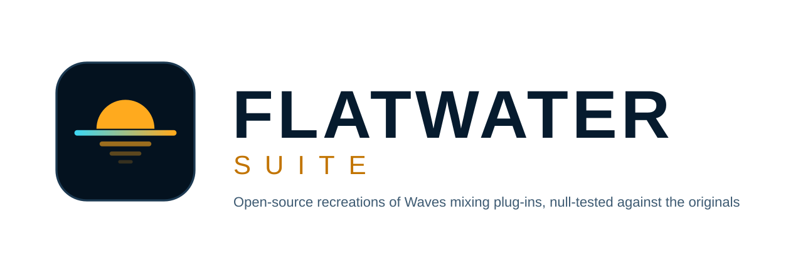
  </picture>

  
  
  
  
  

# Flatwater

Open-source recreations of Waves mixing plug-ins, null-tested against the originals. Every null aims for flat water.
VST3, CLAP, AU and standalone apps for Windows, macOS and Linux.

  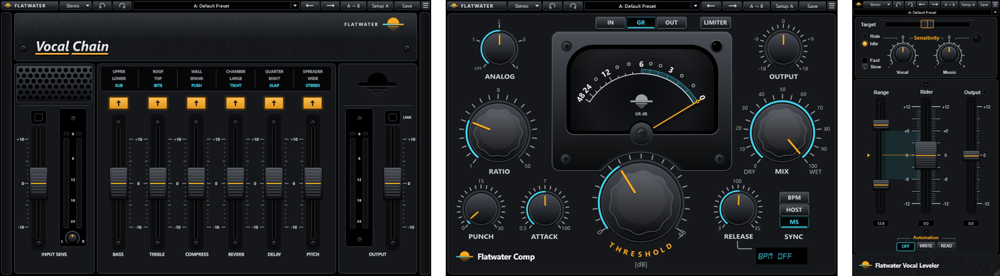

| | Plug-in | Recreates | What it does |
|---|---|---|---|
| 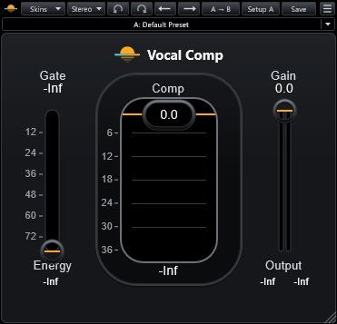 | **[Flatwater Vocal Comp](plugins/FwVocalComp)** | Waves Renaissance Vox | Three-control vocal compressor, gate and limiter |
| 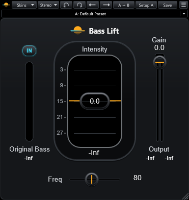 | **[Flatwater Bass Lift](plugins/FwBassLift)** | Waves Renaissance Bass | Psychoacoustic bass enhancer |
| 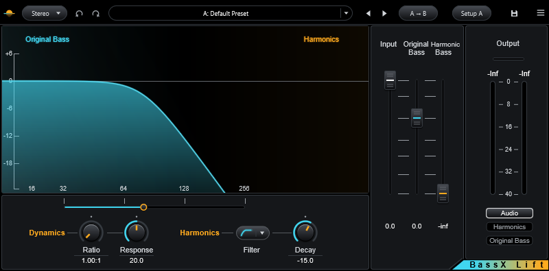 | **[Flatwater BassX Lift](plugins/FwBassXLift)** | Waves MaxxBass | Bass enhancer with a harmonics compressor, filters and monitor modes |
| 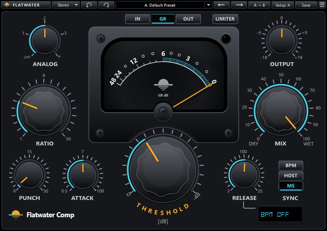 | **[Flatwater Comp](plugins/FwComp)** | Waves H-Comp | Hybrid compressor with punch, tempo-synced release, analog modes and a limiter |
| 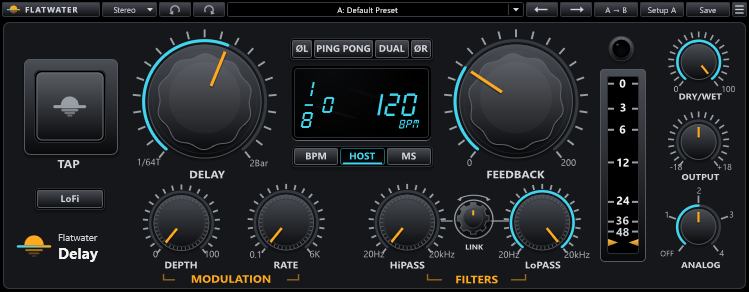 | **[Flatwater Delay](plugins/FwDelay)** | Waves H-Delay | Hybrid delay with tape-style time changes, ping-pong, modulation, filters and LoFi |
| 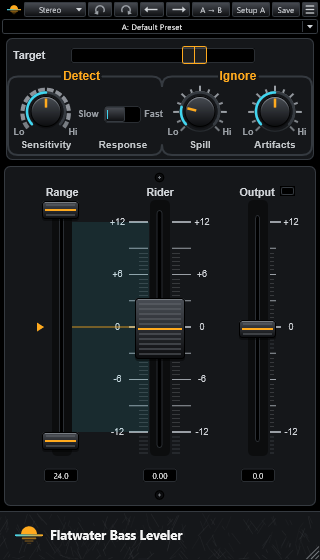 | **[Flatwater Bass Leveler](plugins/FwBassLeveler)** | Waves Bass Rider | Note-by-note bass level rider |
| 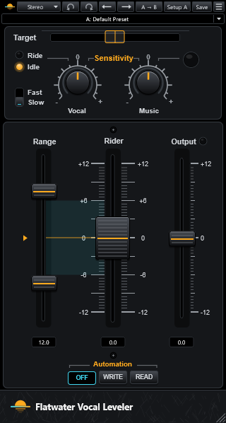 | **[Flatwater Vocal Leveler](plugins/FwVocalLeveler)** | Waves Vocal Rider | Real-time vocal level rider |
| 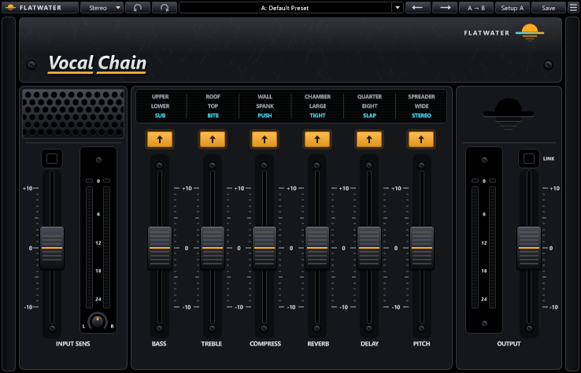 | **[Flatwater Vocal Chain](plugins/FwVocalChain)** | Waves CLA Vocals | One fader per stage vocal chain: EQ, compression, de-essing, reverb, delay, doubling |
| 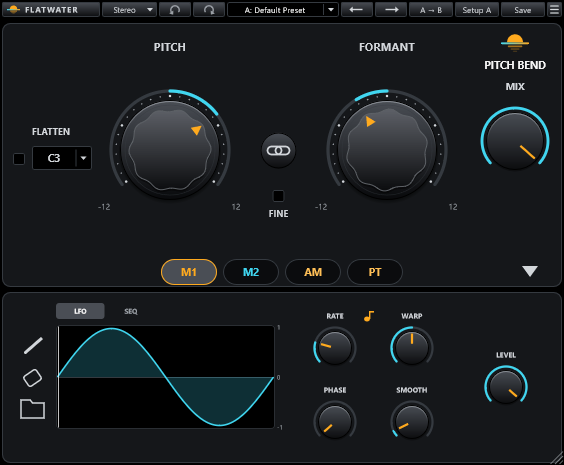 | **[Flatwater Pitch Bend](plugins/FwPitchBend)** | Waves Vocal Bender | Real-time pitch and formant shifter for a voice, with Flatten and four modulators |

> Flatwater is an independent project. It is not affiliated with, endorsed by or sponsored by Waves Audio or
> Chris Lord-Alge. Product names are theirs and only describe what each plug-in is modelled on. No code, models,
> presets or artwork of theirs is included.

## How it was built

Flatwater is made with Claude (Anthropic's AI): the code, the measurements behind it and this documentation. The
originals are the reference for every behaviour; each plug-in's measurements say what was measured and how
([Flatwater Vocal Comp](plugins/FwVocalComp/MEASUREMENTS.md), [Flatwater Bass Lift](plugins/FwBassLift/MEASUREMENTS.md),
[Flatwater BassX Lift](plugins/FwBassXLift/MEASUREMENTS.md), [Flatwater Comp](plugins/FwComp/MEASUREMENTS.md),
[Flatwater Delay](plugins/FwDelay/MEASUREMENTS.md), [Flatwater Bass Leveler](plugins/FwBassLeveler/MEASUREMENTS.md),
[Flatwater Vocal Leveler](plugins/FwVocalLeveler/MEASUREMENTS.md), [Flatwater Vocal Chain](plugins/FwVocalChain/MEASUREMENTS.md),
[Flatwater Pitch Bend](plugins/FwPitchBend/MEASUREMENTS.md)), with the data in
[measurements/](measurements).

## Features

- **Modelled from measurements.** Each plug-in's behaviour is identified from the original's manual and from thousands
  of test renders, then null-tested. The results are published as measured, weak cases included ([How close](#how-close)).
- **The originals' controls and layouts** in Flatwater's own dark look (neutral greys, controls lit from above, cyan values, amber pointers), drawn in
  code, with the originals' factory preset values under Flatwater names.
- **One plug-in per tool.** Mono, stereo and live variants live in one plug-in behind a **Mode** switch (ours).
- **The same toolbar everywhere** (ours): undo and redo, a preset menu with factory presets and your own, A / B setups
  with copy, and a window-size menu.

  

- **Every format from one build:** VST3, CLAP and a standalone app on all three systems, plus AU on macOS.

## Quick start

1. Download the installer for your system from the [latest release](https://github.com/MaymiPR/Flatwater/releases/latest).
   One installer holds every plug-in:

   | System | File | Installs |
   |---|---|---|
   | Windows 10 / 11 (64-bit) | `Flatwater-<version>-Windows-Setup.exe` | VST3 and CLAP to `C:\Program Files\Common Files\`, the standalone apps if you choose, with an uninstaller |
   | macOS 10.13+ (universal) | `Flatwater-<version>-macOS.pkg` | AU, VST3 and CLAP (you choose which), and the standalone apps if you tick them |
   | Linux x86-64 (glibc 2.35+) | `Flatwater-<version>-Linux.tar.gz` | VST3 and CLAP: run `sh install-linux.sh` to copy them to `~/.vst3` and `~/.clap` |

2. Run it, then rescan plug-ins in your DAW.

The release notes say whether a download is signed. An unsigned installer shows a warning the first time:

- **Windows SmartScreen:** *More info*, then *Run anyway*.
- **macOS 15 and later:** open it once, then System Settings > Privacy & Security > *Open Anyway*. Earlier macOS:
  right-click, then *Open*.

Each release lists SHA-256 checksums in `SHA256SUMS.txt`, and its files carry GitHub build provenance attestations
(`gh attestation verify <file> --repo MaymiPR/Flatwater`), so you can check a download.

## Usage

Insert any Flatwater plug-in on a track in a VST3, CLAP or AU host, or open its standalone app. Every editor opens with the
same toolbar:

| Control | What it does |
|---|---|
| Logo | About, the GitHub page, Report an Issue, License |
| Mode (Stereo ▼) | Picks the variant, such as Mono or Stereo |
| ↶ ↷ | Undo and redo |
| Preset box | Default Preset, factory presets, your saved presets, Save As, Show User Presets Folder |
| ← → | Previous and next preset |
| A → B, Setup A / B | Copy the current setup to the other slot; switch between the two |
| Save | Saves the current preset (asks for a name the first time) |
| ☰ | Window size (as a percentage), Apply as Default to All |

Each plug-in's page covers its controls: [Flatwater Vocal Comp](plugins/FwVocalComp#using-it), [Flatwater Bass Lift](plugins/FwBassLift#using-it),
[Flatwater BassX Lift](plugins/FwBassXLift#using-it), [Flatwater Comp](plugins/FwComp#using-it), [Flatwater Delay](plugins/FwDelay#using-it),
[Flatwater Bass Leveler](plugins/FwBassLeveler#using-it), [Flatwater Vocal Leveler](plugins/FwVocalLeveler#using-it),
[Flatwater Vocal Chain](plugins/FwVocalChain#using-it), [Flatwater Pitch Bend](plugins/FwPitchBend#using-it).

## How close

The residual is the difference between the original's output and ours, in dB below the original's level. Lower is
better: −60 dB is inaudible in practice, 0 dB is no match.

| Plug-in | Real material | Synthetic signals | Best parts | Weakest part |
|---|---|---|---|---|
| [Flatwater Vocal Comp](plugins/FwVocalComp/NULLTESTS.md) | not measured | a grid of 672 settings: median −70 dB, worst −23 dB | steady tones at any setting: −95 to −120 dB | dense noise at heavy compression: −24 to −33 dB |
| [Flatwater Bass Lift](plugins/FwBassLift/NULLTESTS.md) | not measured | 12 signals × 8 settings: median −36.8 dB | tones at or above Freq, sweeps, white noise: −43 to −49 dB | very low input at Freq 160 with Original Bass Out (kicks −9 dB) |
| [Flatwater BassX Lift](plugins/FwBassXLift/NULLTESTS.md) | not measured | 12 signals × 8 settings: median −48.5 dB; 120 random settings: median −35.2 dB | white noise and quiet tones: −49 to −59 dB (the created harmonics) | kick-like transients (−19 dB), and extreme settings where the original's own feedback goes unstable |
| [Flatwater Comp](plugins/FwComp/NULLTESTS.md) | not measured | 14 signals × 12 settings: median −48.7 dB, worst −22.1 dB; 26 factory presets: median −44.0 dB | tones and sweeps at the default: −84 dB; Analog mode 4: −82 to −100 dB | low notes under long attacks: −15 to −20 dB on a bass line |
| [Flatwater Delay](plugins/FwDelay/NULLTESTS.md) | not measured | 88 factory presets on drums, bass and voice: median −53.2 dB | the delay path (times, filters, Ping Pong, Feedback to 200 %): −84 to −104 dB | Analog mode 3 (about −41 dB), and a loop that self-oscillates above 100 % Feedback |
| [Flatwater Bass Leveler](plugins/FwBassLeveler/NULLTESTS.md) | real bass parts held out from the fit: median −22 to −26 dB | a bass line at nearly every setting: −30 dB; 17 factory presets: median −24.8 dB | steady tones and level steps: −48 to −49 dB | Response Fast at Sensitivity 100 (worst parts −10 to −17 dB) |
| [Flatwater Vocal Leveler](plugins/FwVocalLeveler/NULLTESTS.md) | vocal parts held out from the identification: −47 to −66 dB | level steps: −74 dB; 13 factory presets: median −60.9 dB | level steps: −74 dB | Attack Fast at word onsets: about −50 dB |
| [Flatwater Vocal Chain](plugins/FwVocalChain/NULLTESTS.md) | held-out vocal parts, the whole chain: median −33.2 dB with the doubler clear, −36.0 dB on Stereo; 43 factory presets: median −30.1 dB | not measured | the Bass, Treble and Reverb stages: median −75.7 dB | the Wide and Spreader doublers, matched in level, spectrum and delay but not sample for sample (medians −9 to −24 dB) |
| [Flatwater Pitch Bend](plugins/FwPitchBend/NULLTESTS.md) | with no shift: −67 dB on a sung take; shifted, matched by what is heard: 62 of 80 factory preset and take pairs within the level, pitch and tone targets | the modulators through Mix: 38 of 38 within 0.003 to 0.01 of the range | no shift, and the modulators' laws (to 0.0001 rms) | any shift on a real voice: its own shifter, so no sample null (a steady vowel cancels to −13 to −27 dB with small Formant moves) |

Each plug-in's name links to every case in its NULLTESTS.md; [docs/RESULTS.md](docs/RESULTS.md) explains each result and how each model was found.

## Building from source

`cmake -B build && cmake --build build --config Release` with CMake 3.22+, Git and a C++17 compiler; the
requirements, the commands per platform and where the plug-ins land are in the [build guide](docs/BUILDING.md).

## Contributing

Found a bug or a difference from the original? Open an
[issue](https://github.com/MaymiPR/Flatwater/issues/new/choose) and attach the settings or a preset that shows it.
To change the code, read [CONTRIBUTING.md](CONTRIBUTING.md) for the tests, the null tests against the originals and
the release steps. Changes per version are in [CHANGELOG.md](CHANGELOG.md); open items per plug-in are in
[docs/IMPROVEMENTS.md](docs/IMPROVEMENTS.md).

## Security

A file that makes a plug-in crash or misbehave is a security bug. Please report it privately, as described in
[SECURITY.md](SECURITY.md), not in a public issue.

## License

Flatwater is open source under the [GNU Affero General Public License v3](LICENSE). It is built with
[JUCE](https://juce.com) (used under the AGPLv3), the VST3 SDK, CLAP and clap-juce-extensions (MIT). Their licenses
are in [THIRD-PARTY-NOTICES.txt](packaging/THIRD-PARTY-NOTICES.txt) and ship with every download. The reference
plug-ins and their artwork are not part of this repository.

Waves, Renaissance Vox, Renaissance Bass, MaxxBass, H-Comp, H-Delay, Bass Rider, Vocal Rider and CLA Vocals are names
of their owners and are used only to describe what each plug-in is modelled on.
