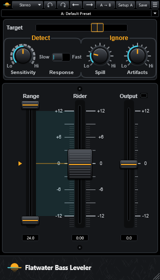

# Flatwater Bass Leveler

Part of [Flatwater](../../README.md). Flatwater Bass Leveler rides the level of a bass track note by note. It
recreates Waves Bass Rider. It finds each note's attack, sustain and release and sets a gain per note toward a target
level. Unlike a compressor, it leaves each note's own envelope alone. The Mode menu picks Stereo, Mono, Live Stereo or
Live Mono. The studio modes look 42 ms ahead, which is their latency; the Live modes use 5 ms.

## Controls

| Control | What it does |
|---|---|
| Target | The level the riding aims at, -42 to 0 dB (default -14). It sits over the Energy meter, which shows the input's energy from -42 to 0 dBFS. It also sets the Rider fader's 0. Set it near the input's average level. |
| Sensitivity | Note detection, 0 to 100 (default 50). Higher settings detect more notes. |
| Response (Slow / Fast) | When the detector resets for the next note. Slow (default) suits long releases, Fast short ones. |
| Spill | -50 to -3 dB (default -40). Signal below it is not detected as notes. |
| Artifacts | 0 to 100 (default 50). Tolerance to buzz, crackles, squeaks and modulation within a note. |
| Range | Two thumbs: Max, -11 to +12 dB (default +12), and Min, -12 to +11 dB (default -12). They stay at least 1 dB apart. The box below shows the effective range. |
| Idle arrow | The Rider's gain when no bass plays, a point inside the range (default: its middle, 0 dB at the default range). |
| Rider | The automatic gain, -12 to +12 dB. Grab it for a manual gain; riding resumes on release. It is not a host parameter. |
| Output | Output gain after the riding, -12 to +12 dB (default 0). |
| Clip LED | Lights when the output reaches 0 dB and stays lit. A click clears it. |

The toolbar is the one every Flatwater plug-in shares: see [the suite README](../../README.md#usage).

## How close

On steady tones and level steps, the level read, the gain law, the look-ahead, the smoothing and the hold match the
original at -48 to -49 dB. A bass line matches at -30 dB at nearly every Sensitivity and Response setting. Real bass
parts held out from the fit come in at a median of -22 to -26 dB per setting. Most of that is a note ridden afresh by
one side and not the other; in a mix it is one note slightly louder or quieter. The match is weakest at Response Fast
and Sensitivity 100. Every case: [NULLTESTS.md](NULLTESTS.md); the factory presets against the original's own:
[NULLTESTS-presets.md](NULLTESTS-presets.md).

## How it was made

What the vendor documents for Bass Rider is in [RESEARCH.md](RESEARCH.md); what was measured and identified is in
[MEASUREMENTS.md](MEASUREMENTS.md).
