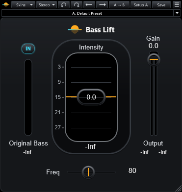

# Flatwater Bass Lift

Part of [Flatwater](../../README.md). Flatwater Bass Lift is a psychoacoustic bass enhancer. It recreates Waves
Renaissance Bass. It creates harmonics of the low end, so the ear hears a fundamental that small speakers cannot play.
It does not create sub-harmonics. Below Freq, the original bass is removed and replaced by the created harmonics,
unless Original Bass is switched in. The Mode menu picks Stereo or Mono.

## Controls

| Control | What it does |
|---|---|
| IN (Original Bass) | Mixes the original signal below Freq back in with the created harmonics. In by default; Out leaves only the harmonics below Freq. |
| Intensity | Level of the created harmonics, -24 to +24 dB (default 0). High settings can distort. |
| Gain | Output level, -30 to 0 dB (default 0). |
| Freq | The frequency the harmonics are created from, 32 to 256 Hz (default 80 Hz), on a logarithmic scale in 1 Hz steps. |
| Original Bass meter | The input's level below Freq, -30 to 0 dB. Its readout holds the peak. |
| Centre window | Level of the created harmonics, 0 to -30 dB. Its readout holds the peak. |
| Output meters | Output level, -30 to 0 dB, with peak readouts. Stereo shows two bars, Mono one. |
| Clip light | Lights when the output's peaks reach the clip level. A click resets it. |

A click on any meter or readout resets all the peak holds.

The toolbar is the one every Flatwater plug-in shares: see [the suite README](../../README.md#usage).

## How close

Over 12 signals and 8 settings, the median residual against the original is -36.8 dB on the whole output and -31.5 dB
on the created harmonics alone. It is weakest at Freq 160 with Original Bass Out on very low input: the output is then
only the created bass, and its level is off there. Every case: [NULLTESTS.md](NULLTESTS.md).

## How it was made

What the vendor documents for Renaissance Bass is in [RESEARCH.md](RESEARCH.md); what was measured and identified is
in [MEASUREMENTS.md](MEASUREMENTS.md).
