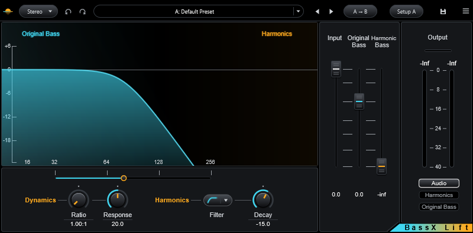

# Flatwater BassX Lift

Part of [Flatwater](../../README.md). Flatwater BassX Lift is a bass enhancer with a harmonics compressor, filters and
monitor modes. It recreates Waves MaxxBass. Below the crossover Frequency, it creates harmonics for the bass, so the
ear hears a fundamental that small speakers cannot play. Above it, the signal passes unaltered. Separate faders set
the level of the original bass and of the harmonics. An upward compressor works on the harmonics only. The Mode menu
picks Stereo or Mono.

## Controls

| Control | What it does |
|---|---|
| Frequency slider | The crossover, 32 to 256 Hz (default 80 Hz), on a logarithmic scale in 1 Hz steps. |
| Ratio | Upward compression of the harmonics, 1.00:1 to 4.00:1 (default 1.00:1, no compression). Higher ratios make the harmonics louder and less dynamic. |
| Response | Attack and release of the harmonics compressor together, 10 to 30 ms (default 20). |
| Filter | High-pass on the harmonics: 6 dB/oct (wideband, mostly DC removal), 12 dB/oct at Frequency (default) or 24 dB/oct at Frequency. |
| Decay | The level step from each harmonic to the next, -24 to -9 dB (default -15). Nearer 0 is richer. A typed 15 means -15. |
| Input | Input level, -inf to 0 dB (default 0). Presets leave it alone. |
| Original Bass | Level of the original low band, -inf to +12 dB (default 0). |
| Harmonic Bass | Level of the created harmonics, -inf to +12 dB. The default is -inf, so the default setting adds nothing. |
| Audio / Harmonics / Original Bass | What is heard: the output, the harmonics alone, or the low band being removed, alone. |
| Output meters | Level of the monitored signal, 0 to -40 dB, with peak readouts. Stereo shows two bars, Mono one. |
| Clip light | The red bar above the meters. It lights when the output reaches full scale. |
| Graph | Shows the original bass band (blue) and the harmonics band (orange). It follows Frequency, the two level faders, the filter and Decay. |

A click on a meter, a readout or the clip light resets the peaks and the clip light.

The toolbar is the one every Flatwater plug-in shares: see [the suite README](../../README.md#usage).

## How close

Over 12 signals and 8 settings, the median residual against the original is -48.5 dB on the whole output and -42.7 dB
on the created harmonics alone. Kick-like transients are the weakest signal (-19 dB on the harmonics). The worst cases
are loud material at extreme settings, where the original's own harmonic feedback goes unstable. Every case:
[NULLTESTS.md](NULLTESTS.md).

## How it was made

What the vendor documents for MaxxBass is in [RESEARCH.md](RESEARCH.md); what was measured and identified is in
[MEASUREMENTS.md](MEASUREMENTS.md).
