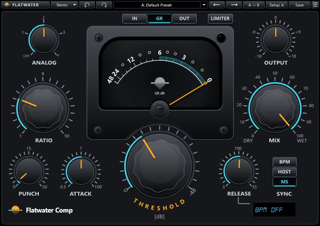

# Flatwater Comp

Part of [Flatwater](../../README.md). Flatwater Comp is a hybrid compressor: a precise compressor with modelled analog
colour. It recreates Waves H-Comp. Punch lets transients through even at a fast attack. The release can follow the
tempo. Mix blends in the dry signal for parallel compression. Makeup gain is automatic, so the compressed and
uncompressed levels stay about the same. An output limiter or a clipper catches the peaks. The Mode menu picks Stereo
or Mono.

## Controls

| Control | What it does |
|---|---|
| ANALOG | Off or 1 to 4 (default 2). Modes 1 to 3 add harmonics and a small amount of noise. Mode 4 adds drive without noise. |
| IN / GR / OUT | What the VU meter shows: the input level, the gain reduction (default) or the output level. |
| LIMITER | On: an output peak limiter. Off (default): a clipper instead. The lamp at the top right of the meter lights when the output stage reduces the level. |
| OUTPUT | Output gain, -18 to +18 dB (default 0). |
| VU meter | A needle on a 0 to -48 dB scale. In GR it shows the total gain reduction, mix and limiter included. |
| RATIO | 1 to 50 (default 3). |
| MIX | Dry to wet, 0 to 100 (default 100). Presets leave it alone. |
| THRESHOLD | 0 to -48 dB (default -18). A typed 18 means -18. |
| PUNCH | 0 to 30 (default 1). Lets transients through the compressor, even with a very fast attack. |
| ATTACK | 0.5 to 100 ms (default 7), on a logarithmic scale. |
| RELEASE | With Sync on MS: 3 to 3000 ms (default 100), on a logarithmic scale. With BPM or HOST: a note value from 1/64T to 2 Bar (default 1/32D). |
| BPM / HOST / MS | Sync. MS: the release in milliseconds (default). HOST: note values at the host's tempo. BPM: note values at the tempo in the display. |
| BPM display | Shows BPM OFF in MS and the host's tempo in HOST. In BPM, drag it or type a tempo, 30 to 300. |

The toolbar is the one every Flatwater plug-in shares: see [the suite README](../../README.md#usage).

## How close

Over 14 signals and 12 settings, the median residual against the original is -48.7 dB and the worst is -22.1 dB. The
original's 26 factory presets match at a median of -44.0 dB. It is weakest on low notes under long attacks (30 to 60
ms: -15 to -20 dB on a bass line). Analog modes 1 to 3 add random noise, as the original does, which no null can
remove. Every case: [NULLTESTS.md](NULLTESTS.md); the factory presets against the original's own:
[the presets null test](NULLTESTS.md#presets).

## How it was made

What the vendor documents for H-Comp is in [RESEARCH.md](RESEARCH.md); what was measured and identified is in [MEASUREMENTS.md](MEASUREMENTS.md).
