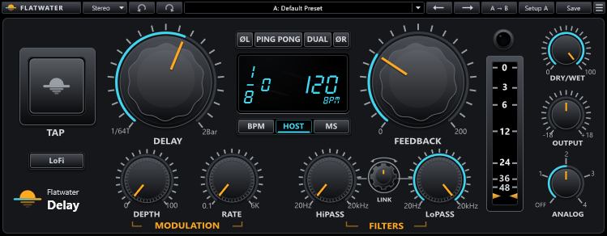

# Flatwater Delay

Part of [Flatwater](../../README.md). Flatwater Delay is a hybrid delay for slap-back, echoes, ping-pong, flanging and
chorus. It recreates Waves H-Delay. A change of delay time glides like a tape machine changing speed: the echoes
already recorded change pitch until the new time settles. It has tempo sync, a tap pad, feedback up to 200 %,
modulation, filters, a LoFi mode and analog colour. The Mode menu picks Stereo, Mono or M>S (mono in, stereo out).

## Controls

| Control | What it does |
|---|---|
| TAP | Sets the delay to the time between the last two taps (up to 3500 ms). With HOST it snaps to the nearest note value; with BPM it sets the tempo instead. |
| LoFi | The reduced sample rate of early digital delays. The delay range stays the same. |
| DELAY | With Sync on MS: 1 to 3500 ms (default 375). With BPM or HOST: a note value from 1/64T to 2 Bar (default 1/8D). In Dual it sets the side chosen on the display. |
| ØL / ØR | Inverts the left or the right delay line. Mono shows a single Ø. |
| PING PONG | Two delay lines feeding each other. The L or R box on the display picks the start side; a click flips it. |
| DUAL | Separate left and right times: click or drag either half of the display. Feedback, modulation and the filters stay common. |
| Display | Shows the time as a note value and tempo, or in ms. Drag or scroll on the time or the tempo to change it. |
| BPM / HOST / MS | Sync. MS: milliseconds. HOST: note values at the host's tempo (default). BPM: note values at the tempo in the display. |
| FEEDBACK | 0 to 200 % (default 60). Below 100 the repeats decay; above 100 they build up. |
| Output meter | Output level on a 0 to -48 dBFS scale. The clip light above it lights at 0 dBFS. |
| DRY/WET | 0 to 100 (default 100). Presets leave it alone. |
| OUTPUT | -18 to +18 dB (default 0). |
| ANALOG | Off or 1 to 4 (default 2). Modes 1 to 3 add noise, as the original does. |
| DEPTH | Modulation depth, 0 to 100 % (default 0). |
| RATE | Modulation rate, 0.1 Hz to 6 kHz (default 0.1 Hz), on a logarithmic scale. |
| HiPASS | High-pass filter: Off at the bottom (the default), then 20 Hz to 20.1 kHz. |
| LoPASS | Low-pass filter: 19 Hz up to Off at the top (the default). |
| LINK | A wheel that moves both filters together, like a band-pass. |

The toolbar is the one every Flatwater plug-in shares: see [the suite README](../../README.md#usage).

## How close

The delay path nulls against the original at -84 to -104 dB: the defaults, ms and synced times, the filters, Ping Pong
from either side and Feedback up to 200 %. Modulation matches at -61 to -81 dB, and the original's 88 factory presets
at a median of -53.2 dB. Analog mode 3 is the weakest part (about -41 dB). Modes 1 to 3 add random noise, as the
original does, which no null can remove. Every case: [NULLTESTS.md](NULLTESTS.md); the factory presets against the
original's own: [NULLTESTS-presets.md](NULLTESTS-presets.md).

## How it was made

What the vendor documents for H-Delay is in [RESEARCH.md](RESEARCH.md); what was measured and identified is in [MEASUREMENTS.md](MEASUREMENTS.md).
