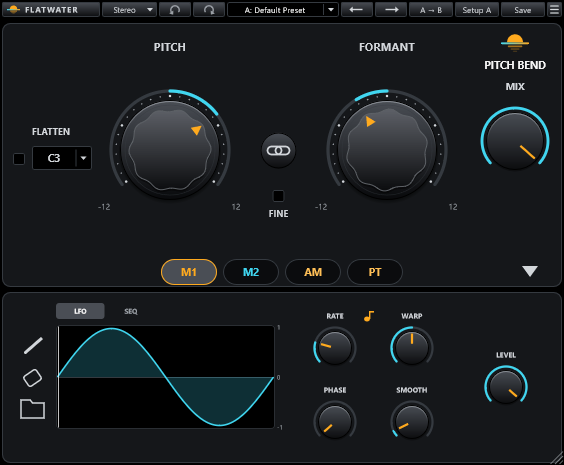

# Flatwater Pitch Bend

Part of [Flatwater](../../README.md). Flatwater Pitch Bend moves the pitch and the formants of a single voice in real
time. It recreates Waves Vocal Bender. Pitch shifts the notes without changing the timing; Formant changes the voice's
character (its size) without changing the notes. Flatten holds the whole voice on one note, and four modulators (two
LFO or step-sequencer modulators, the voice's own loudness and its own pitch) can move any control. There is no
latency. Made for a solo voice: chords and mixes pass mostly unshifted.

## Using it

| Control | What it does |
|---|---|
| PITCH | -12 to +12 semitones (default 0), or -1200 to +1200 cents with Fine on. |
| FORMANT | -12 to +12 semitones (default 0), or in cents with Fine on. Negative is deeper and looser, positive tighter and smaller. |
| Fine | Switches Pitch and Formant between whole semitones and cents. |
| LINK | The small knob between Pitch and Formant: moves both together, keeping their offset, and stops when either reaches its end. |
| MIX | 0 % (dry) to 100 % (default, only the shifted voice). |
| FLATTEN | Holds the voice on the note beside it (C2 to B3; default C3). Combined with modulation on Pitch it plays melodies. |
| M1, M2 tabs | An LFO or a step sequencer each: Rate (0.06 to 30 Hz free, or 1/64 to 8 bars synced to the host), Phase, Warp (0.01 to 100), Smooth (1 to 1000), Level, and for the sequencer Steps (2 to 16, values -24 to +24 semitones). Our own set of shapes (sine, triangle, square, saws, ramp, S-curve, half sine, pulses, steps, random) or a shape you draw. |
| AM tab | The voice's loudness as a modulator: Attack and Release (0.1 to 1000 ms), Level (0 to 2). |
| PT tab | The voice's pitch as a modulator: Smooth (1 to 1000), Offset (-1 to +1, the note it swings about), Level (0 to 2). |
| Modulation slots | Drag a tab's label onto a control (Pitch, Formant, Mix, M1's and M2's Rate, Warp, Phase and Level, AM's three controls, PT's Smooth and Level): up to four per control, each with its own depth, dragged up and down (Alt-click resets it). Right-click a slot to change or remove it. |

The toolbar is the one every Flatwater plug-in shares: see [the suite README](../../README.md#usage). The reference's
40 factory presets come with Flatwater names, in six groups: Character, Harmony, Double, Movement, Robot and Sequence.
Where a preset used one of the original's drawn LFO shapes, ours uses the nearest of our own (we do not ship the
drawn ones).

## How close

With every control at 0 the output is the input, delayed as the reference's (-67 dB residual on a sung take). Once
anything shifts, Flatwater Pitch Bend is its own pitch shifter (a pitch detector and overlap-added grains), so it is
compared by what is heard rather than sample for sample: the shifter matches the reference on all its scorecard
measures but one (pitch accuracy, formant envelope, onsets and jumps, noise, Flatten, the gate; the miss is a few
level cells where the reference's own level varies within one setting), the modulators on all 38 of
their null cases (to 0.0001 ... 0.006 of the control's range, rms), and 62 of the 80 factory preset and take pairs meet
every target for level, pitch and tone. On a steady vowel the grains sit where the reference's do: up to -27 dB of
cancellation with small Formant moves. On a real voice the reference rebuilds the sound from its own period
estimates, so no recreation nulls it sample for sample. Every case: [NULLTESTS.md](NULLTESTS.md) and
[NULLTESTS-presets.md](NULLTESTS-presets.md).

## How it was made

What the vendor documents for the original is in [RESEARCH.md](RESEARCH.md), and what was measured and identified is in
[MEASUREMENTS.md](MEASUREMENTS.md).
