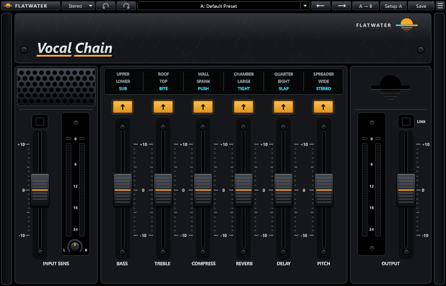

# Flatwater Vocal Chain

Part of [Flatwater](../../README.md). Flatwater Vocal Chain is a whole vocal chain on six faders: EQ, compression,
de-essing, reverb, delay and doubling. It recreates Waves CLA Vocals. Each fader drives one stage of a fixed chain. A
colour button above each fader picks one of three flavours or the clear position. The Bass and Treble faders act only
once moved; the other faders are active at 0 and give the default sound there. The Mode menu picks Stereo or
Mono/Stereo (mono in, stereo out).

## Using it

| Control | What it does |
|---|---|
| INPUT SENS | Input sensitivity, -10 to +10 dB (default 0). Presets leave it alone. The LED above it shows the input level: off (too low), green (good), yellow (optimal), red (very hot). |
| Input meter | Input level, 0 to 24 dB down, with clip lights. A click on the meter clears them. |
| Balance | The small knob under the input meter, -6 to +6 dB (default 0). Stereo mode only. |
| BASS | -10 to +10 (default 0). Colours Sub (default), Lower, Upper, or Bypass. |
| TREBLE | -10 to +10 (default 0). Colours Bite (default), Top, Roof, or Bypass. |
| COMPRESS | -10 to +10 (default 0). Colours Push (default), Spank, Wall, or Bypass. |
| REVERB | The reverb's wet level, -10 to +10 (default 0). Colours Tight (default), Large, Chamber, or Mute. |
| DELAY | The delay's wet level, -10 to +10 (default 0), synced to the host's tempo. Colours Slap (a 1/16 note, default), Eight (1/8), Quarter (1/4), or Mute. |
| PITCH | The wet level of a pitch modulation for chorusing and doubling, -10 to +10 (default 0). Colours Stereo (default), Wide, Spreader, or Mute. |
| Colour buttons | A click steps to the next flavour, then to the clear position. A click on a flavour's name selects it; a click on the lit name turns the colour off. |
| OUTPUT | Output level, -10 to +10 dB (default 0), with an output meter and clip lights. Presets leave it alone. |
| LINK | Links Input Sens and Output: Output mirrors Input Sens (+3 in, -3 out). This is Flatwater Vocal Chain's own addition. |

The toolbar is the one every Flatwater plug-in shares: see [the suite README](../../README.md#usage).

## How close

On held-out vocals at 48 kHz the whole chain's median residual against the original is -33.2 dB with the doubler clear
and -36.0 dB on its default Stereo colour; the Bass, Treble and Reverb stages alone reach -75.7 dB. At 44.1 and 96 kHz
the chain with the doubler clear reaches -32.1 and -35.5 dB. The 43 factory presets, which carry the original's values
under Flatwater names, have a median of -30.1 dB. The doubler's Wide and Spreader colours are pitch shifters that pick
their splice points from the signal, so they do not null sample for sample; their level, spectrum and delay range
match the original's. Every case: [NULLTESTS.md](NULLTESTS.md) and [NULLTESTS-presets.md](NULLTESTS-presets.md).

## How it was made

What the vendor documents for the original is in [RESEARCH.md](RESEARCH.md), and what was measured and identified is in [MEASUREMENTS.md](MEASUREMENTS.md).
