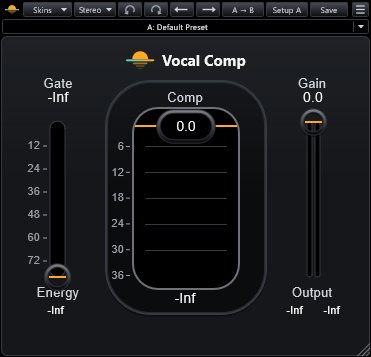

# Flatwater Vocal Comp

Part of [Flatwater](../../README.md). Flatwater Vocal Comp is a vocal compressor, gate and limiter behind three
controls. It recreates Waves Renaissance Vox. Comp sets how hard the voice is compressed: lowering it adds gain
reduction and raises the level, and a peak limiter holds the output. Gate is a gentle downward expander before the
compressor. Gain sets the output level. The Mode menu picks Stereo or Mono.

## Controls

| Control | What it does |
|---|---|
| Gate | Threshold of the downward expander, -80 to 0 dB. At -80 dB it reads -Inf and the gate is off (the default). |
| Comp | Compression, -36 to 0 dB (default 0). Lower settings add gain reduction and raise the level into the limiter. |
| Gain | Output gain, -36 to 0 dB (default 0). |
| Energy meter | The input's energy, -80 to 0 dB, under the Gate fader. Its readout holds the peak. |
| Centre window | Total gain reduction of the compressor and the gate. Its readout holds the deepest value. |
| Output meters | Output level, -36 to 0 dB, with peak readouts. Stereo shows two bars, Mono one. |

A click on any meter or readout resets all the peak holds.

The toolbar is the one every Flatwater plug-in shares: see [the suite README](../../README.md#usage). The factory
presets carry the original's values under Flatwater names.

## How close

Over a 672-case grid of settings the median residual against the original is -70 dB and the worst is -23 dB. Steady
tones null at -95 to -120 dB at any setting. The match is weakest on dense noise at heavy compression (-24 to
-33 dB). Every case: [NULLTESTS.md](NULLTESTS.md); the grid of settings: [NULLTESTS-grid.md](NULLTESTS-grid.md).

## How it was made

What the vendor documents for the original is in [RESEARCH.md](RESEARCH.md); what was measured, identified and
learned is in [MEASUREMENTS.md](MEASUREMENTS.md).
