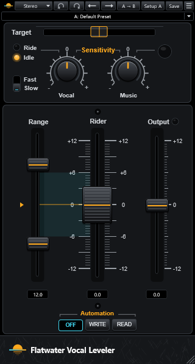

# Flatwater Vocal Leveler

Part of [Flatwater](../../README.md). Flatwater Vocal Leveler rides the level of a vocal in real time, like a hand on
the fader. It recreates Waves Vocal Rider. It adds no latency and needs no pre-scan. It changes only the gain, not the
tone. Its voice detector finds the starts and ends of words and tells the voice from noise, spill and ambience. It is
meant as the last plug-in on a vocal track or group. The Mode menu picks Stereo, Mono, Live Stereo or Live Mono. The
Live modes add the Spill control.

## Controls

| Control | What it does |
|---|---|
| Target | The vocal level the riding aims at, -42 to 0 dB (default -21). It sits over the vocal level meter (-42 to 0 dBFS). It also sets the Rider fader's 0. |
| Ride / Idle LEDs | Ride lights while a voice is detected, Idle while none is. |
| Fast / Slow | Attack: the detection timing and the riding speed. Slow is the default. |
| Vocal | Vocal Sensitivity, -12 to +12 dB (default 0). The threshold of the voice detector. |
| Music | Music Sensitivity, Off or -12 to +12 dB (default 0). It reads the music on the side-chain input and is greyed out without one. The riding does not use the music yet. The LED beside it brightens as the music gets louder. |
| Spill (Live modes) | -48 to -12 dB (default -48). Signal below it is treated as stage noise, not voice. |
| Range | Two thumbs: Max, -11 to +12 dB (default +6), and Min, -12 to +11 dB (default -6). They stay at least 1 dB apart. The box below shows the effective range. |
| Idle arrow | The Rider's gain when no voice is detected, a point inside the range (default: its middle, 0 dB at the default range). |
| Rider | The automatic gain, -12 to +12 dB. Grab it for a manual gain; riding resumes on release. |
| Output | Output gain after the riding, -12 to +12 dB (default 0). The clip LED above it lights when the output reaches 0 dB and stays lit; a click clears it. |
| OFF / WRITE / READ | Automation. OFF: the engine rides. WRITE: the Rider's moves go to the host's Rider Fader parameter, for its automation lane. READ: the Rider plays the host's automation back and ignores the engine. |

The toolbar is the one every Flatwater plug-in shares: see [the suite README](../../README.md#usage). The 13 factory
presets carry the original's values under Flatwater names.

## How close

Against the original, level steps match at -74 dB, and vocal parts held out from the identification at -47 to -66 dB.
That holds at Studio and Live, Slow and Fast, other Targets, ranges and Idle values, Stereo, and at 44.1 and 96 kHz.
Attack Fast is the weakest (about -50 dB), at word onsets. The original's 13 presets match at a median of -60.9 dB.
The Music side-chain is not covered: Flatwater Vocal Leveler rides without it. Every case: [NULLTESTS.md](NULLTESTS.md);
the factory presets against the original's own: [NULLTESTS-presets.md](NULLTESTS-presets.md).

## How it was made

What the vendor documents for the original is in [RESEARCH.md](RESEARCH.md); what was measured and identified is in
[MEASUREMENTS.md](MEASUREMENTS.md).
